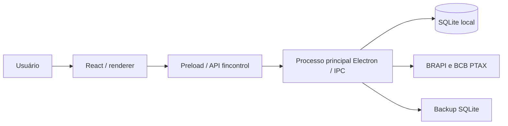

# Arquitetura e regras técnicas — FinControl 1.6.4

## Estrutura

O renderer apresenta dados e validações de conveniência. O preload expõe operações delimitadas; o processo principal executa validação, persistência e consultas externas. O código usa TypeScript; SQLite via node:sqlite; gráficos com Recharts. A aplicação local não exige servidor próprio nem conta bancária conectada. A navegação de fontes oficiais abre o navegador, não importa documentos automaticamente.

| Local | Responsabilidade |
|---|---|
| src/main/database.ts | Inicialização, transações e acesso ao banco |
| src/main/contas.ts / cartoes.ts / salarios.ts | Contas, transferências, faturas, parcelamentos e recorrência |
| src/main/investimentos.ts | Posições, movimentos, cotações e históricos |
| src/main/cotacoes.ts / servicoCotacoes.ts / fundamentos.ts | Provedores e validação de dados externos |
| src/main/backup.ts | Exportação consistente, integridade e restauração |
| src/main/index.ts / src/preload/index.ts | IPC, ciclo de vida e smoke tests |
| src/renderer/src/ | Componentes, tema, paginação e visualização |
| tests/ | Regras financeiras, consistência, regressão e benchmark sintético |

## Invariantes

- Dinheiro em centavos inteiros nas operações persistidas; quantidades de investimento podem usar até oito casas decimais, dentro dos limites validados.
- Transferência não altera patrimônio bancário agregado. Compra e venda de investimento alteram caixa somente quando registradas explicitamente. Compra debita bruto + taxas; venda/provento credita bruto − taxas. Cadastro inicial não movimenta conta.
- Pagamentos e estornos mantêm histórico e evitam baixa duplicada; conferir regras em cartoes.ts e testes.
- Custo inicial não conhecido impede cálculo completo de rentabilidade. Patrimônio não é retorno. Cotações sem valor permanecem desconhecidas; observações diárias não preenchem artificialmente períodos.
- SQLite usa consultas parametrizadas nas operações; a restauração valida integridade e gera snapshot antes da troca. A chave opcional BRAPI é separada do banco e protegida via safeStorage quando disponível.
- O Harden adicionou prévia, trava síncrona de operações na carteira e recuperação após falha de recarga. O Optimize limita a renderização de históricos a 25 linhas e usa índice por ID; não altera a ordem ou persistência.

## Homologação

Consulte [resultados e limitações](HOMOLOGACAO_V1.md). As mudanças em regras financeiras exigem testes no main e de regressão no EXE. O sistema usa GitHub Actions; nenhum dado financeiro pessoal deve entrar nas fixtures. Não alegar certificação de segurança, benchmark integral ou conformidade bancária com base nos smoke tests.

## Trabalhos futuros

Histórico retroativo de mercado com fonte validada, calendário de dividendos e importação regulatória são propostas futuras, não funcionalidades entregues. Outros sistemas operacionais e auditoria de segurança independente não fazem parte da homologação.
